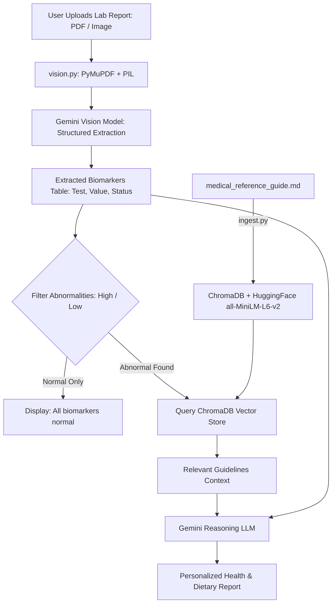

# 🩺 Multimodal AI Medical Lab Analyzer

An end-to-end AI-powered Medical Lab Report Analyzer that bridges the gap between complex diagnostic laboratory reports and actionable, patient-friendly guidance. Many individuals struggle to interpret blood test results due to dense medical jargon, irregular reference intervals, and confusing multi-column table layouts.

This project solves that problem with a two-stage multimodal pipeline:
1. **Multimodal Vision AI**: Accurately "reads" scanned PDFs and images, extracting critical biomarkers into structured schema using Google Gemini Vision.
2. **Retrieval-Augmented Generation (RAG)**: Cross-references abnormal biomarkers against a local vector database of standard medical reference guidelines (ChromaDB + HuggingFace Embeddings) to generate grounded, plain-English dietary and lifestyle recommendations.

---

## 📸 Screenshots & Application Walkthrough

### 1. Home & Upload Interface
Upload scanned blood test reports in PNG, JPG, or PDF formats.


### 2. Document Preview
Interactive preview of the uploaded report before running multimodal extraction.


### 3. Structured Biomarker Extraction
Gemini Vision extracts test names, measured values, units, and high/low flags into a structured table.


### 4. Personalized AI Advice & Medical Reasoning
The local RAG pipeline retrieves relevant medical reference standards and produces grounded dietary and lifestyle suggestions.


---

## 🌟 Key Features

- **Multimodal Ingestion**: Supports single/multi-page `.pdf` documents and images (`.png`, `.jpg`, `.jpeg`).
- **Structured Vision Extraction**: Leverages Google Gemini Flash with Pydantic structured outputs to extract biomarkers (`test_name`, `value`, `unit`, `status`) without manual OCR tuning.
- **Local RAG Pipeline**: Powered by ChromaDB and local HuggingFace embeddings (`all-MiniLM-L6-v2`) to retrieve clinical dietary guidelines.
- **Abnormality Filtering**: Intelligently identifies High/Low flags to focus reasoning on actionable health metrics.
- **Grounded Medical Reasoning**: Prompts ensure the LLM strictly recommends dietary protocols supported by the retrieved reference knowledge base.
- **Streamlit Web UI**: Simple, responsive interface with table visualization and formatted recommendations.

---

## 🏗️ Architecture & Workflow



---

## 🛠️ Tech Stack

- **Frontend**: Streamlit
- **Document Processing**: PyMuPDF (`fitz`), Pillow (`PIL`)
- **Schema Validation**: Pydantic v2
- **Vision & Reasoning LLM**: Google Gemini (`gemini-flash-latest`) via `langchain-google-genai`
- **Orchestration**: LangChain (`langchain-core`, `langchain-chroma`, `langchain-huggingface`)
- **Embeddings**: HuggingFace (`sentence-transformers/all-MiniLM-L6-v2`)
- **Vector Database**: ChromaDB (Runs locally)

---

## 📁 Project Structure

```
├── app.py                      # Streamlit web user interface
├── vision.py                   # Multimodal extraction pipeline using Gemini Vision
├── rag_chain.py                # Retrieval-Augmented Generation reasoning chain
├── ingest.py                   # Vector database ingestion script
├── medical_reference_guide.md  # Knowledge base of medical reference ranges & dietary advice
├── chroma_db/                  # Local persistent Chroma vector database
├── sample.png                  # Sample Complete Blood Count (CBC) test report
├── requirements.txt            # Project dependencies
└── README.md                   # Project documentation
```

---

## 🚀 Setup & Installation

### 1. Clone the Repository
```bash
git clone <your-repo-url>
cd Multimodal-AI-Assistant
```

### 2. Create and Activate Virtual Environment
```powershell
python -m venv venv
.\venv\Scripts\Activate
```

### 3. Install Dependencies
```bash
pip install -r requirements.txt
```

### 4. Configure Environment Variables
Create a `.env` file in the root directory:
```env
GOOGLE_API_KEY=your_gemini_api_key_here
```

### 5. Ingest Reference Data into ChromaDB
Run the ingestion script to chunk and embed `medical_reference_guide.md` into your local ChromaDB vector store:
```bash
python ingest.py
```

### 6. Launch the Application
Start the Streamlit application:
```powershell
streamlit run app.py
```
*(Or directly: `.\venv\Scripts\streamlit.exe run app.py`)*

Open your browser at `http://localhost:8501`.

---

## ⚠️ Disclaimer

This is an experimental AI application built for educational and informational purposes. The dietary and lifestyle suggestions are generated by an artificial intelligence model based on general reference guidelines and **do not constitute professional medical advice, diagnosis, or treatment**. Always consult a qualified physician or healthcare provider regarding any lab results or medical conditions.
